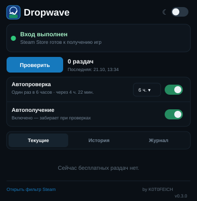

  
  <h1>🎁 Dropwave</h1>
  <strong>Steam Free-to-Keep Game Tracker & Auto-Claimer</strong>
  
Минималистичное браузерное расширение для поиска и получения временно бесплатных игр Steam. 
  A minimal browser extension that tracks and optionally claims limited-time free Steam games.

  
<strong>v0.3.1</strong> · Chromium Manifest V3 · Brave / Chrome

  
<a href="#-русский">Русский</a> · <a href="#-english">English</a>

---

## 🖥️ Интерфейс / Interface

  
  
Пример минималистичного меню (демонстрационные данные). / Minimal popup preview (illustrative values).

**Скачать / Download:** [Releases](https://github.com/fataxd/Dropwave-/releases) · [История изменений / Changelog](CHANGELOG.md)

---

## 🇷🇺 Русский

### Что такое Dropwave?

**Dropwave** — бесплатное расширение для браузеров на базе Chromium, которое следит за акциями **Free to Keep** в магазине Steam. Если платная игра временно стала бесплатной, расширение покажет её и, по желанию пользователя, попробует добавить в библиотеку через уже активную сессию Steam Store.

**Важно:** это не каталог всех бесплатных игр. Dropwave предназначен именно для временных раздач ранее платных игр, а не для обычных Free-to-Play и бесплатных выходных (Free Weekend).

### Возможности

- 🔎 Поиск временно бесплатных игр со скидкой **100%**.
- 🎮 Ручное получение кнопкой **«Забрать в библиотеку»**.
- ⚙️ Опциональное **автополучение** через авторизованную сессию Steam Store (выключено по умолчанию).
- ⏰ Автопроверка каждые **6, 12 или 24 часа**; уведомления о новых акциях.
- 🕒 Оставшееся время акции, если Steam позволяет его определить.
- 📋 Вкладки **«Текущие»**, **«История»**, **«Журнал»**.
- ✅ Журнал успешных операций, ошибок и неподтверждённых запросов.
- 👤 Раздельный учёт данных для Steam-аккаунтов; ручная отметка не равна подтверждённой лицензии.
- 🌓 Компактный интерфейс с тёмной и светлой темами.
- 🌐 **Русский и английский интерфейс**: переключатель **RU / EN** в шапке, сохранение языка и автоматический выбор по языку браузера.

### Установка в Brave или Google Chrome

1. Скачайте ZIP с исходниками проекта и **распакуйте** его в постоянную папку.
2. Откройте страницу расширений: **`brave://extensions/`** (или **`chrome://extensions/`**).
3. Включите **«Режим разработчика»**.
4. Нажмите **«Загрузить распакованное расширение»** / **Load unpacked**.
5. Выберите папку, в которой находится **`manifest.json`** (не сам ZIP).
6. В **том же профиле браузера** войдите на [store.steampowered.com](https://store.steampowered.com/).
7. Откройте Dropwave и нажмите **«Проверить»**. Если нужно, включите **«Автополучение»**.

> **Обновление:** сохраните резервную копию папки, замените файлы новой версией **по прежнему пути**, затем нажмите «Обновить» на странице расширений. Не удаляйте установленное расширение: его локальные данные привязаны к профилю/ID.

### Как работает автополучение?

Расширение открывает страницу акции в неактивной вкладке Steam Store, проверяет предложение и авторизацию, определяет Steam Package ID (**SubID**) и запрашивает бесплатную лицензию средствами Steam. Затем пытается проверить наличие игры в библиотеке. Если подтверждения пока нет, операция получает промежуточный статус.

**Dropwave не гарантирует получение каждой раздачи.** Steam может менять разметку и API, ограничивать предложения по региону, требовать подтверждения возраста либо повторного входа. При сомнениях проверьте библиотеку Steam вручную.

### Безопасность и конфиденциальность

- Dropwave **не запрашивает и не хранит пароль или Steam Guard-коды**.
- Авторизация происходит на официальном сайте Steam; используется существующая браузерная сессия.
- Данные истории, настроек и журнала сохраняются локально через `chrome.storage.local`.
- Разрешение на доступ к сайтам ограничено `https://store.steampowered.com/*`.
- Для фоновых проверок **браузер должен быть запущен**. Это не самостоятельный круглосуточный сервис.

### Устройство проекта

| Файл | Назначение |
| --- | --- |
| `manifest.json` | Конфигурация и разрешения браузерного расширения |
| `background.js` | Поиск, фоновые проверки, получение лицензий и уведомления |
| `i18n.js`, `_locales/` | Localized UI strings and extension description |
| `popup.html`, `popup.css`, `popup.js` | Минималистичное меню расширения |
| `icons/` | Оригинальные иконки Dropwave |
| `CHANGELOG.md` | История версий |
| `README.txt` | Подробные технические примечания к сборке |

---

## 🇬🇧 English

### What is Dropwave?

**Dropwave** is a free, lightweight Chromium-based browser extension that tracks **limited-time Free-to-Keep promotions** on Steam. When a previously paid game becomes temporarily free, Dropwave displays it and can optionally attempt to claim it using your **existing Steam Store browser session**.

**Note:** Dropwave targets temporary 100%-off promotions for previously paid games. It excludes ordinary Free-to-Play games and Free Weekends.

### Features

- 🔎 Detect **100%-discounted**, limited-time free Steam games.
- 🎮 **Manual claiming** through the extension popup.
- ⚙️ Optional **automatic claiming**, disabled by default.
- ⏰ Scheduled checks every **6, 12, or 24 hours** and desktop notifications.
- 🕒 Giveaway countdown when Steam exposes an end date.
- 📋 **Current**, **History**, and **Journal** tabs.
- ✅ Claim journal for successful, failed, and pending/unverified actions.
- 👤 Account-specific claim records; manual marks do not count as verified ownership.
- 🌓 Compact dark/light themes.
- 🌐 **Russian and English UI**: **RU / EN** switch in the popup header; language selection is remembered, with browser-language detection by default.

### Installation (Brave / Chrome)

1. Download the project ZIP and **extract it** to a permanent folder.
2. Open **`brave://extensions/`** or **`chrome://extensions/`**.
3. Enable **Developer mode**.
4. Click **Load unpacked**.
5. Select the folder containing **`manifest.json`** (not the ZIP itself).
6. Sign in at [store.steampowered.com](https://store.steampowered.com/) using **the same browser profile**.
7. Open Dropwave, select **Check**, and optionally enable **Auto Claim**.

> **Updating:** back up the existing extension folder, replace its files **at the same path**, then click **Reload** on the Extensions page. Removing and reinstalling the extension may lose locally stored data if its extension ID changes.

### How does auto-claim work?

Dropwave opens the Steam product page in an inactive tab, verifies the offer and current Store session, identifies the Steam package (**SubID**), and sends a free-license request through Steam. It then attempts to verify ownership. When ownership is not yet confirmed, the operation is shown as **pending/unverified** rather than guaranteed success.

**There is no guarantee every promotion can be claimed.** Steam may change its page structure or endpoints, impose regional restrictions, request age verification, or require you to sign in again. Check your Steam library when a result is uncertain.

### Privacy & security

- Dropwave **does not ask for or store Steam passwords or Steam Guard codes**.
- Authentication stays on Steam's official site; your existing browser session is used.
- History, preferences, and the operation journal are stored locally in `chrome.storage.local`.
- Website access is limited to **`https://store.steampowered.com/*`**.
- **Your browser must be running** for scheduled background checks. This is not a 24/7 server-side service.

### Project files

| File | Purpose |
| --- | --- |
| `manifest.json` | Extension metadata and browser permissions |
| `background.js` | Detection, scheduling, notifications, and license requests |
| `popup.html`, `popup.css`, `popup.js` | Minimal extension interface |
| `icons/` | Original Dropwave artwork |
| `CHANGELOG.md` | Version history |
| `README.txt` | Detailed Russian release notes |

---

## Author / Автор

**K0T0FEICH** · [Pikabu](https://pikabu.ru/@K0T0FEICH)

**Disclaimer / Отказ от ответственности:** Dropwave is an independent, unofficial project and is **not affiliated with Valve or Steam**. / Dropwave — независимый неофициальный проект, **не связанный с Valve или Steam**.

**License / Лицензия:** No license has been selected yet. / Лицензия пока не выбрана.
